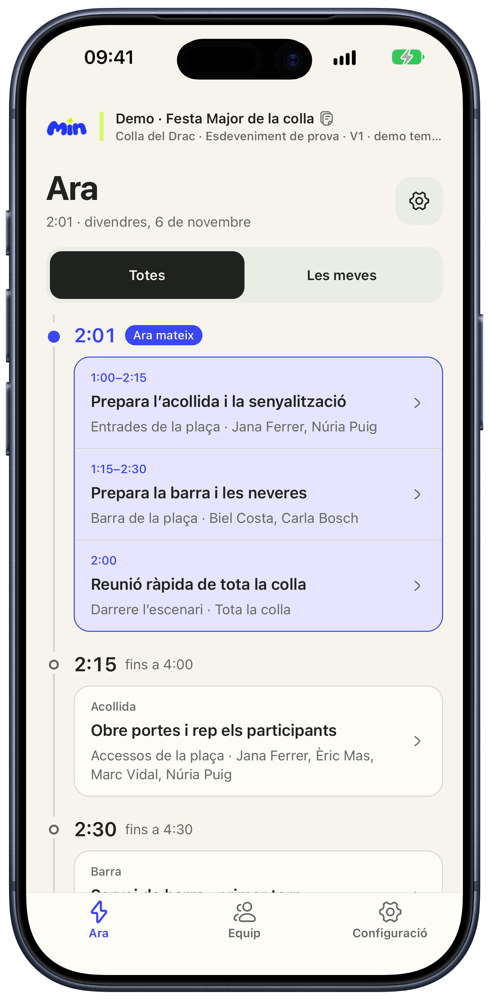
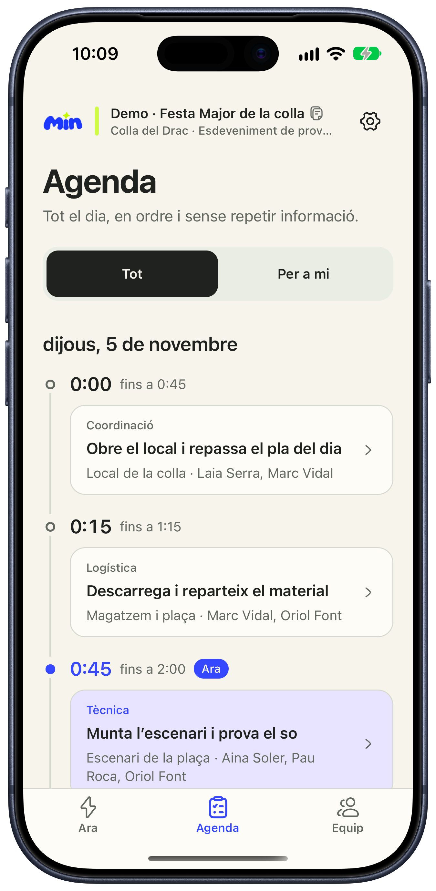
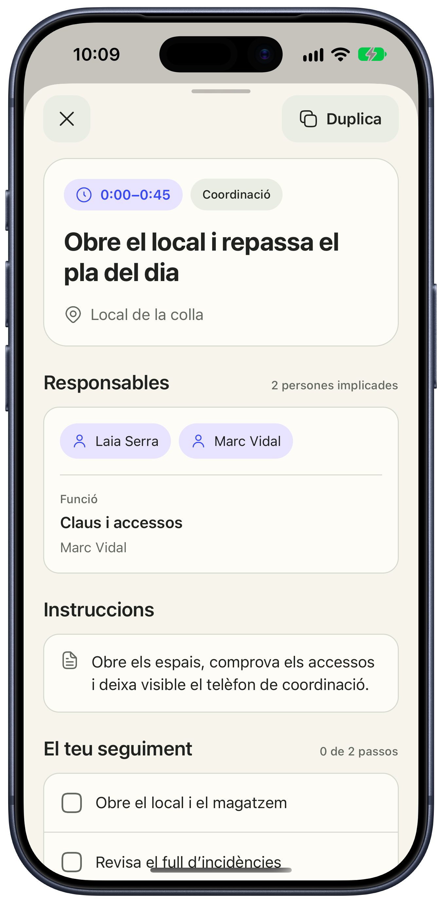

# min

<p align="center">
  
</p>

<p align="center"><strong>El minut a minut compartit d’una colla.</strong></p>

<p align="center">
  Una persona prepara l’esdeveniment i la resta sap què toca, on i amb qui, fins i tot sense cobertura.
</p>

<p align="center">
  <a href="https://min.didac.dev/">Web</a> ·
  <a href="https://min.didac.dev/crea/">Crea un document</a> ·
  <a href="https://min.didac.dev/privacitat/">Privacitat</a> ·
  <a href="https://min.didac.dev/suport/">Suport</a>
</p>

<p align="center">
  
  
  
</p>

## Què és min?

**min** converteix l’horari d’una festa, un acte o una jornada en una guia clara per a tothom que hi participa. Funciona en català a iOS, Android i web, sense compte, backend, analítica ni publicitat.

- **Local-first:** SQLite és la font de veritat i les dades es queden al dispositiu.
- **Offline:** la consulta i l’edició no depenen de la cobertura.
- **Compartició explícita:** els documents viatgen com a fitxers amb noms com `festa-major.minut.json`; no hi ha sincronització automàtica.
- **Revisions segures:** una còpia rebuda és de consulta i s’ha de duplicar abans d’editar-la.
- **Accessible:** admet text dinàmic, etiquetes accessibles i modes clar, fosc o del sistema.

## Què permet fer?

### Per a qui segueix l’esdeveniment

- Veure què passa ara i què ve després.
- Consultar l’agenda sencera i les tasques simultànies.
- Filtrar per persona o equip.
- Obrir llocs, responsables, instruccions i checklists.
- Rebre avisos locals i consultar el widget o la Live Activity.

### Per a qui el prepara

- Crear esdeveniments, tasques, equips, persones, funcions i dependències.
- Revisar solapaments, assignacions, equips buits i funcions pendents.
- Desar esborranys i publicar revisions explícites.
- Importar i exportar fitxers `<nom>.minut.json`, generar PDF i crear còpies de seguretat.
- Preparar una primera estructura amb la IA que triï l’usuari, sense integrar cap proveïdor dins de min.

## Com funciona la compartició?

1. Una persona crea o importa un esdeveniment.
2. En revisa les dades i publica una revisió.
3. Comparteix el fitxer `<nom>.minut.json` pels canals habituals del dispositiu.
4. La resta l’importa i veu sempre quina revisió té i quan la va rebre.

No hi ha sincronització en segon pla. min no presenta mai una còpia com a actualitzada si no en té evidència.

## Desenvolupament

### Requisits

- Node.js 24 i npm 11.
- Xcode i CocoaPods per a iOS.
- Android Studio i l’Android SDK per a Android.

### Instal·lació

```bash
npm ci
```

Per executar l’app amb Expo Go:

```bash
npm start
```

Expo Go permet provar l’app, però no incorpora `ExpoWidgets`. Els widgets i la Live Activity necessiten una development build:

```bash
npx expo prebuild
npx pod-install ios
npm run start:dev-client
```

Quan canviïn dependències natives o `app.config.ts`, cal regenerar i reinstal·lar la development build.

### Ordres habituals

| Ordre | Funció |
| --- | --- |
| `npm run ios` | Executa l’app a iOS |
| `npm run android` | Executa l’app a Android |
| `npm run web` | Executa l’app Expo al navegador |
| `make web` | Inicia la landing i el generador web |
| `make web-build` | Genera el lloc estàtic a `web/dist` |
| `make web-assets` | Regenera les captures de producte i la imatge social |
| `make check` | Executa Astro Check, ESLint, TypeScript i Vitest |
| `npm run doctor` | Comprova la configuració d’Expo |

La landing queda disponible a `http://127.0.0.1:4321`. Es pot canviar l’adreça o el port:

```bash
make web HOST=0.0.0.0 PORT=3000
```

## Arquitectura

```text
src/
├── app/       rutes i pantalles d’Expo Router
├── db/        SQLite, migracions, revisions, esborranys i preferències
├── domain/    model, càlcul temporal i validació Zod
├── features/  importació, exportació, IA, avisos i superfícies natives
├── ui/        components i tokens visuals
└── widgets/   widgets d’iOS/Android i Live Activity d’iOS

web/           landing Astro i generador local de documents
metadata/      metadades públiques de l’App Store
.maestro/      recorreguts funcionals bàsics
```

El kit de disseny original, els tokens i l’especificació de pantalles viuen a [`min-kit-disseny/`](min-kit-disseny/).

## Format `<nom>.minut.json`

Tots els documents tenen un nom visible abans del sufix `.minut.json`, per exemple `correfoc-2026.minut.json`. min no genera fitxers anomenats simplement `.minut.json`, que alguns sistemes tractarien com a ocults.

- MIME: `application/vnd.min.document+json`
- UTI: `com.dsd.min.document`
- Contracte actual: `schemaVersion: 1`
- Contracte executable: [`src/domain/schema.ts`](src/domain/schema.ts)

La importació valida UUID, dates amb desplaçament horari, zones IANA, referències, límits temporals i cicles abans d’escriure a SQLite. Les marques personals i els checklists completats no formen part del fitxer compartit.

## Crea amb IA

min no integra cap model ni envia documents a tercers. La pantalla `/ai-assistant` genera unes instruccions que l’usuari pot copiar a la IA que vulgui:

1. copia les instruccions;
2. les enganxa a la IA i hi adjunta el document original;
3. descarrega el fitxer `<nom>.minut.json` generat;
4. l’importa a min i el revisa abans de publicar-lo.

El prompt prohibeix inventar dades i demana aclariments quan el document és ambigu. Un fitxer generat per IA no es considera mai una font de veritat.

## Qualitat

```bash
make check
npm run doctor
```

Amb una build instal·lada i [Maestro](https://maestro.mobile.dev/) disponible:

```bash
maestro test .maestro
```

Els canvis de widgets, avisos, importació de documents o Live Activity també s’han de validar en dispositius reals.

## Límits coneguts

- Els avisos són locals i depenen dels permisos del sistema.
- El sistema operatiu decideix quan refresca widgets i Live Activities.
- No hi ha sincronització entre dispositius.
- El PDF és una còpia de consulta, no un document versionat.
- Les superfícies natives no estan disponibles a la versió web.

## Crear un fork

Abans de distribuir un fork, canvia com a mínim:

- el bundle/package, l’App Group i el tipus de document d’`app.config.ts`;
- els identificadors de `.maestro/` i `.argent/flows/`;
- els dominis i les metadades de `web/`, `metadata/` i `wrangler.jsonc`;
- el nom, les icones i qualsevol recurs de marca reservat.

Els projectes natius `ios/` i `android/` es generen amb Expo Prebuild i no formen part del repositori.

Per a una distribució pròpia a l’App Store, crea el fitxer local de contacte abans d’aplicar les metadades:

```bash
cp metadata/review-information.example.json metadata/review-information.json
```

Aquest fitxer i els artefactes locals de distribució de `.asc/` estan exclosos de Git.

## Contribuir i seguretat

Les contribucions són benvingudes. Llegeix [`CONTRIBUTING.md`](CONTRIBUTING.md) i el [`CODE_OF_CONDUCT.md`](CODE_OF_CONDUCT.md) abans d’obrir una proposta.

No publiquis vulnerabilitats ni documents reals amb dades personals en una incidència. Consulta [`SECURITY.md`](SECURITY.md) per informar-ne de manera privada.

## Llicència i marca

El codi i la documentació es publiquen sota la [llicència MIT](LICENSE). Copyright © 2026 Dídac Sabatés.

El nom **min**, els logotips, les icones, les captures promocionals i la identitat visual no queden llicenciats sota MIT. Consulta [`TRADEMARKS.md`](TRADEMARKS.md) i [`THIRD_PARTY_NOTICES.md`](THIRD_PARTY_NOTICES.md) per conèixer-ne els detalls.
